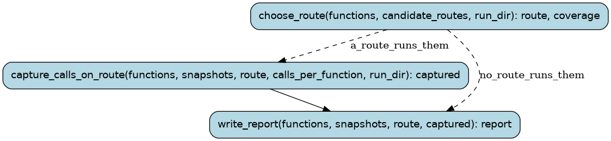

# capture

Capture the original game's own calls of some functions (the inputs that
difftest and the CPU oracle check conversions on): pick a recorded route
that executes them, replay it on the original, save the first calls of each.
(docs/PROCESS.md §4: "capture 40 calls each on a route that runs them".)

Runs are tracked in the Burr UI under project `recomp-capture`.

## Steps

### `choose_route` (step)

Pick the route whose coverage profile executes the most of the functions.

- reads: `functions: tuple[FunctionName, ...]`, `candidate_routes: tuple[Route, ...]`, `run_dir: Path`
- produces: `route: Route | NotRun`, `coverage: tuple[RouteCoverage, ...]`
- then: `capture_calls_on_route` when `a_route_runs_them`; `write_report` when `no_route_runs_them`

### `capture_calls_on_route` (step)

Replay the route on the original game and save the first calls of each function.

- reads: `functions: tuple[FunctionName, ...]`, `snapshots: SnapshotDir`, `route: Route`, `calls_per_function: int`, `run_dir: Path`
- produces: `captured: tuple[CapturedCalls, ...]`
- then: `write_report`

### `write_report` (step)

Say where the calls are and which functions were never called.

- reads: `functions: tuple[FunctionName, ...]`, `snapshots: SnapshotDir`, `route: Route | NotRun`, `captured: tuple[CapturedCalls, ...]`
- produces: `report: CaptureReport`
- then: the run ends
