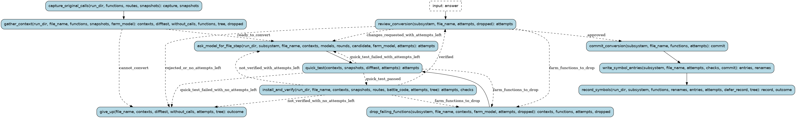

# convert

A strong outside model converts a subsystem (callers and callees together)
to readable C with C call and return semantics (docs/PROCESS.md §4): capture
the original's calls, ask the model for the whole file, quick-test it per
function against the lifted originals, install it and run the full verify,
then stop for the orchestrator's review. Failures and review comments go back
to the model (3 attempts per model, then the next model). A group of farm
candidates goes the same way, except that failing functions are taken out of
it (they stay in the farm's pool) instead of going to a model. Approved work is
committed, its symbols/db entries are written from the model's drafts plus the
run's own evidence, and a child record run renames and documents it.
The orchestrator never writes the code: it chooses the work and reviews.

Runs are tracked in the Burr UI under project `recomp-convert`.

## Steps

### `capture_original_calls` (step)

Save the original game's calls of the functions (a child capture run), unless given a capture.

- reads: `run_dir: Path`, `functions: tuple[FunctionName, ...]`, `routes: tuple[Route, ...]`, `snapshots: typing.Optional[SnapshotDir]`
- produces: `capture: CaptureReport | NotRun`, `snapshots: SnapshotDir`
- then: `gather_context`

### `gather_context` (step)

Each function's assembly, lifted C and register contract, and that it has captured calls (no model is
asked to write what nothing could check); labels callers enter in the middle of a function join the
subsystem (a replacement must define them); build the host difftest for quick tests.

- reads: `run_dir: Path`, `file_name: str`, `functions: tuple[FunctionName, ...]`, `snapshots: SnapshotDir`, `farm_model: typing.Optional[ModelSpec]`
- produces: `contexts: tuple[ConversionContext, ...] | NotRun`, `difftest: Path | BuildFailure`, `without_calls: tuple[FunctionName, ...]`, `functions: tuple[FunctionName, ...]`, `tree: Path`, `dropped: tuple[DroppedFunction, ...]`
- then: `ask_model_for_file_step` when `ready_to_convert`; `give_up` when `cannot_convert`

### `ask_model_for_file_step` (step)

Ask the next model for the whole file (passing over a rate-limited provider); after a failure or
review, show it what went wrong.

- reads: `run_dir: Path`, `subsystem: str`, `file_name: str`, `contexts: tuple[ConversionContext, ...]`, `models: tuple[ModelSpec, ...]`, `rounds: int`, `candidate: Path | None`, `farm_model: typing.Optional[ModelSpec]`, `attempts: tuple[Attempt, ...]`
- produces: `attempts: tuple[Attempt, ...]`
- then: `quick_test`

### `give_up` (step)

Take the file out of the tree again and say why there is nothing to commit.

- reads: `file_name: str`, `contexts: tuple[ConversionContext, ...] | NotRun`, `difftest: Path | BuildFailure`, `without_calls: tuple[FunctionName, ...]`, `attempts: tuple[Attempt, ...]`, `tree: Path | None`
- produces: `outcome: ConvertOutcome`
- then: the run ends

### `quick_test` (step)

Each function of the file against its lifted original on the captured calls and random inputs.

- reads: `contexts: tuple[ConversionContext, ...]`, `snapshots: SnapshotDir`, `difftest: Path`, `attempts: tuple[Attempt, ...]`
- produces: `attempts: tuple[Attempt, ...]`
- then: `install_and_verify` when `quick_test_passed`; `drop_failing_functions` when `farm_functions_to_drop`; `ask_model_for_file_step` when `quick_test_failed_with_attempts_left`; `give_up` when `quick_test_failed_with_no_attempts_left`

### `install_and_verify` (step)

Put the file in the tree and run every check (a child verify run); take it out again if it fails.

- reads: `run_dir: Path`, `file_name: str`, `contexts: tuple[ConversionContext, ...]`, `snapshots: SnapshotDir`, `routes: tuple[Route, ...]`, `battle_code: bool`, `attempts: tuple[Attempt, ...]`, `tree: Path | None`
- produces: `attempts: tuple[Attempt, ...]`, `checks: tuple[FunctionChecks, ...]`
- then: `review_conversion` when `verified`; `drop_failing_functions` when `farm_functions_to_drop`; `ask_model_for_file_step` when `not_verified_with_attempts_left`; `give_up` when `not_verified_with_no_attempts_left`

### `drop_failing_functions` (step)

A farm group keeps what passes: the functions the quick test, the verify or the review named
are taken out (they stay in the farm's pool), and the rest is assembled again and re-tested.

- reads: `subsystem: str`, `file_name: str`, `contexts: tuple[ConversionContext, ...]`, `farm_model: typing.Optional[ModelSpec]`, `attempts: tuple[Attempt, ...]`, `dropped: tuple[DroppedFunction, ...]`
- produces: `contexts: tuple[ConversionContext, ...]`, `functions: tuple[FunctionName, ...]`, `attempts: tuple[Attempt, ...]`, `dropped: tuple[DroppedFunction, ...]`
- then: `quick_test`

### `review_conversion` (pause point)

The orchestrator reviews: approve, request changes (they go back to the model) or reject.

- reads: `subsystem: str`, `file_name: str`, `attempts: tuple[Attempt, ...]`, `dropped: tuple[DroppedFunction, ...]`
- waits for: `Review` (`decision: ReviewDecision`, `comments: str`, `attribution: str`, `drop: tuple[FunctionName, ...]`)
- produces: `attempts: tuple[Attempt, ...]`
- then: `commit_conversion` when `approved`; `drop_failing_functions` when `farm_functions_to_drop`; `ask_model_for_file_step` when `changes_requested_with_attempts_left`; `give_up` when `rejected_or_no_attempts_left`

### `commit_conversion` (step)

Put the file and its difftest.cfg lines into the main tree and commit them there (locally, never
pushed), holding the main tree's lock: parallel runs share difftest.cfg.

- reads: `subsystem: str`, `file_name: str`, `functions: tuple[FunctionName, ...]`, `attempts: tuple[Attempt, ...]`
- produces: `commit: CommitHash`
- then: `write_symbol_entries`

### `write_symbol_entries` (step)

symbols/db entries from the model's drafts plus this run's evidence; renames for confirmed/probable meanings.

- reads: `subsystem: str`, `file_name: str`, `attempts: tuple[Attempt, ...]`, `checks: tuple[FunctionChecks, ...]`, `commit: CommitHash`
- produces: `entries: tuple[Path, ...]`, `renames: tuple[Rename, ...]`
- then: `record_symbols`

### `record_symbols` (step)

Check the entries, rename in bn6f, write the comments, re-verify, commit (a child record run); or, when
runs go in parallel, commit the entries and leave the renames to one batch record (PENDING_RENAMES).

- reads: `run_dir: Path`, `subsystem: str`, `functions: tuple[FunctionName, ...]`, `renames: tuple[Rename, ...]`, `entries: tuple[Path, ...]`, `attempts: tuple[Attempt, ...]`, `defer_record: bool`, `tree: Path | None`
- produces: `record: RecordReport | None`, `outcome: ConvertOutcome`
- then: the run ends
