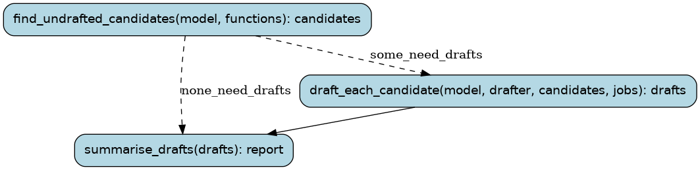

# drafts

A farm model drafts the symbols/db entries of its accepted candidates that
have none yet (tools/convert/accepted/NAME.MODEL.yaml), in parallel: the
documentation small functions bring into the convert workflow's review and
record. New farm runs draft as they accept; this catches up older ones.

Runs are tracked in the Burr UI under project `recomp-drafts`.

## Steps

### `find_undrafted_candidates` (step)

The model's accepted candidates without a drafted entry.

- reads: `model: ModelSpec`, `functions: tuple[FunctionName, ...] | None`
- produces: `candidates: tuple[Path, ...]`
- then: `draft_each_candidate` when `some_need_drafts`; `summarise_drafts` when `none_need_drafts`

### `draft_each_candidate` (step)

Ask the model for each candidate's entry, several at a time.

- reads: `model: ModelSpec`, `drafter: typing.Optional[ModelSpec]`, `candidates: tuple[Path, ...]`, `jobs: int`
- produces: `drafts: tuple[Draft, ...]`
- then: `summarise_drafts`

### `summarise_drafts` (step)

How many entries were written, and which candidates got none (and why).

- reads: `drafts: tuple[Draft, ...]`
- produces: `report: DraftsReport`
- then: the run ends
