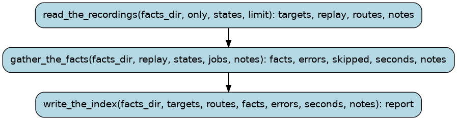

# facts

`wf facts`: the runtime-facts layer -- a record of what the ORIGINAL game actually does at
runtime, for every lifted function, built once from the recordings and with no model judgment
in it. Step 1 of the runtime checking: the later steps (a claim checker, an mGBA intervention
runner) read what this writes and decide what to do with it.

    python -m wf facts [--only NAME]... [--states K=8] [--jobs J=6] [--limit N]

Three steps, in order:

  1. `read_the_recordings` folds every `tools/traces/coverage/*.prof` and `*.edges` into
     per-function coverage (executed yes/no, cycles, the indirect call sites that reached it
     and their callers, calls per 1000 frames with the route lengths read from `wf/routes.py`
     at run time), picks the functions in this run, and writes every record that needs no
     mGBA: the ones whose captured calls have not changed since the last run, and the ones
     with no captured calls at all.
  2. `gather_the_facts` replays K captured entry states per function through mGBA
     (`tools/runtime_evidence.py`'s replay, summarised with its `summarise`) with --jobs
     functions at a time, and folds what the original did into each record. A function whose
     replay crashes or times out is recorded with its `facts_error`; it never stops the run.
  3. `write_the_index` writes `build/facts/coverage.tsv` and says what the run produced.

Output (regenerable, never committed):

    build/facts/by_address/0x08XXXXXX.json    one record per function, keyed by entry address
    build/facts/coverage.tsv                  one row per function
    build/facts/progress.txt                 what the run did, as it did it

Nothing under bn6f or symbols/db is touched and no model is called: a function's name is a
field of its record, never its key.

Runs are tracked in the Burr UI under project `recomp-facts`.

## Steps

### `read_the_recordings` (step)

Every recorded route's `.prof` and `.edges`, folded into per-function coverage, and
every record that needs no mGBA written: the functions whose captured entry states and
replay inputs are unchanged since the last run (their facts are kept; the coverage is
re-read when a recording moved under it), and the functions with no captured calls.

- reads: `facts_dir: Path`, `only: tuple[FunctionName, ...]`, `states: int`, `limit: int`
- produces: `targets: tuple[Target, ...]`, `replay: tuple[Target, ...]`, `routes: tuple[RouteName, ...]`, `notes: tuple[ToolMessage, ...]`
- then: `gather_the_facts`

### `gather_the_facts` (step)

Replay K of each function's captured entry states in the original game (mGBA, the same
replay `wf runtime-evidence` does) with --jobs functions at once, and fold what the
original did -- registers in and out, the RAM it wrote by bn6f symbol, the I/O registers
it wrote, the arguments it was given and the r0 it returned -- into its record.

Nothing here stops the run: a function whose replay crashes, times out or never returns
is written with its `facts_error` and the run carries on.

- reads: `facts_dir: Path`, `replay: tuple[Target, ...]`, `states: int`, `jobs: int`, `notes: tuple[ToolMessage, ...]`
- produces: `facts: int`, `errors: int`, `skipped: int`, `seconds: float`, `notes: tuple[ToolMessage, ...]`
- then: `write_the_index`

### `write_the_index` (step)

`build/facts/coverage.tsv` (one row per function: address, name, reached, the routes
that reached it, calls per 1000 frames, captured states, whether it has facts, the
error) and the run's own report.

- reads: `facts_dir: Path`, `targets: tuple[Target, ...]`, `routes: tuple[RouteName, ...]`, `facts: int`, `errors: int`, `seconds: float`, `notes: tuple[ToolMessage, ...]`
- produces: `report: FactsReport`
- then: the run ends
