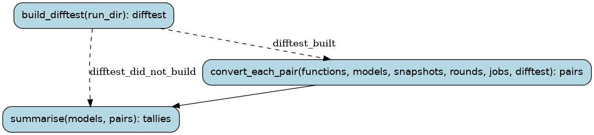

# farm-batch

Outside models convert small lifted functions in volume (docs/PROCESS.md
§4). One `farm` run is one function and one model: the model
writes readable C, the farm's acceptance test checks it against the lifted
original on the captured calls and random inputs, failures go back to the
model for repair. `--prompt old` asks with the prompt before the typed one (register-form C, no
register check; docs/reviews/2026-10-10-benchmark.md): its rounds and candidates are filed under the
model tagged `+old` (FUNC.minimax_MiniMax-M3+old.c), a pair of its own. With the typed prompt (typed-2),
a round starts from the best attempt so far, another model's included (the hand-over,
wf/tools/handover.py), and a passing candidate is kept with the generated wrappers it calls. (Entries for accepted functions are drafted afterwards by `wf drafts --drafter`, on a
plan's quota rather than the farm model's.) Earlier: an accepted function got its symbols/db entry drafted
by the same model. A `farm batch` run builds the host difftest once, skips
pairs that are already finished, and runs the rest as its child runs.

Runs are tracked in the Burr UI under project `recomp-farm`.

## Steps

### `build_difftest` (step)

Build the host difftest once, from the last commit in a worktree of its own (a stale one once
accepted bad candidates; one built from the main tree saw a conversion's verify half done). Each
prompt's batches have a tree of their own, so batches of the two can run side by side.

- reads: `run_dir: Path`, `prompt: PromptKind`
- produces: `difftest: Path | BuildFailure`
- then: `convert_each_pair` when `difftest_built`; `summarise` when `difftest_did_not_build`

### `convert_each_pair` (step)

Run one farm run per function and model (in parallel), skipping pairs finished before
(accepted, or out of rounds: farm.py's resume rule). A pair is a model and a prompt: a model that
tried a function with the typed prompt may still try it with the old one.

- reads: `functions: tuple[FunctionName, ...]`, `models: tuple[ModelSpec, ...]`, `snapshots: SnapshotDir`, `rounds: int`, `prompt: PromptKind`, `jobs: int`, `difftest: Path`
- produces: `pairs: tuple[PairResult, ...]`
- then: `summarise`

### `summarise` (step)

How many functions each model converted (tools/convert/scorecard.py has the cost).

- reads: `models: tuple[ModelSpec, ...]`, `pairs: tuple[PairResult, ...]`
- produces: `tallies: tuple[ModelTally, ...]`
- then: the run ends
