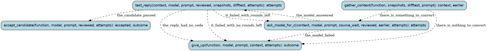

# farm

Outside models convert small lifted functions in volume (docs/PROCESS.md
§4). One `farm` run is one function and one model: the model
writes readable C, the farm's acceptance test checks it against the lifted
original on the captured calls and random inputs, failures go back to the
model for repair. `--prompt old` asks with the prompt before the typed one (register-form C, no
register check; docs/reviews/2026-10-10-benchmark.md): its rounds and candidates are filed under the
model tagged `+old` (FUNC.minimax_MiniMax-M3+old.c), a pair of its own. With the typed prompt (typed-2),
a round starts from the best attempt so far, another model's included (the hand-over,
wf/tools/handover.py), and a passing candidate is kept with the generated wrappers it calls. (Entries for accepted functions are drafted afterwards by `wf drafts --drafter`, on a
plan's quota rather than the farm model's.) Earlier: an accepted function got its symbols/db entry drafted
by the same model. A `farm batch` run builds the host difftest once, skips
pairs that are already finished, and runs the rest as its child runs.

Runs are tracked in the Burr UI under project `recomp-farm`.

## Steps

### `gather_context` (step)

Find the function's assembly, lifted C and register contract, and its captured calls; for the
typed prompt, also every earlier attempt at it, tested today (the hand-over).

- reads: `function: FunctionName`, `snapshots: SnapshotDir`, `difftest: Path`, `prompt: PromptKind`
- produces: `context: ConversionContext | NotRun`, `earlier: tuple[Tried, ...]`
- then: `ask_model_for_c` when `there_is_something_to_convert`; `give_up` when `there_is_nothing_to_convert`

### `ask_model_for_c` (step)

Ask the model (or the first source of a tier that is up) for readable C. The typed prompt starts from
the best attempt so far (another model's, or one of this run's) with every problem its test found and a
history line of the others; the old prompt shows the last failure and its code.

- reads: `context: ConversionContext`, `model: ModelSpec`, `prompt: PromptKind`, `source_wait: float`, `reviewed: ReviewedCandidate | None`, `earlier: tuple[Tried, ...]`, `attempts: tuple[Attempt, ...]`
- produces: `attempts: tuple[Attempt, ...]`
- then: `test_reply` when `the_model_answered`; `give_up` when `the_model_failed`

### `give_up` (step)

Record why there is no accepted candidate.

- reads: `function: FunctionName`, `model: ModelSpec`, `prompt: PromptKind`, `context: ConversionContext | NotRun`, `attempts: tuple[Attempt, ...]`
- produces: `outcome: FarmOutcome`
- then: the run ends

### `test_reply` (step)

Test the model's candidate the way farm.py accepts one (the register check only for the typed
prompt), and log the round as farm.py does.

- reads: `context: ConversionContext`, `model: ModelSpec`, `prompt: PromptKind`, `reviewed: ReviewedCandidate | None`, `snapshots: SnapshotDir`, `difftest: Path`, `attempts: tuple[Attempt, ...]`
- produces: `attempts: tuple[Attempt, ...]`
- then: `accept_candidate` when `the_candidate_passed`; `give_up` when `the_reply_had_no_code`; `ask_model_for_c` when `it_failed_with_rounds_left`; `give_up` when `it_failed_with_no_rounds_left`

### `accept_candidate` (step)

Keep the passing candidate in tools/convert/accepted for review (filed under the model tagged with
its prompt when that is not the typed one; a typed one with the generated wrappers it calls and the
tool's register-form notes, so it stands on its own).

- reads: `function: FunctionName`, `model: ModelSpec`, `prompt: PromptKind`, `reviewed: ReviewedCandidate | None`, `attempts: tuple[Attempt, ...]`
- produces: `accepted: Path`, `outcome: FarmOutcome`
- then: the run ends
