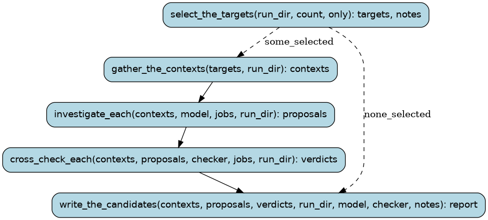

# investigate

Cheap models investigate placeholder-named functions of the bn6f disassembly in volume and write
*candidate* symbols/db entries for review (docs/PROCESS.md §4's farm, pointed at documentation
instead of code): pick the functions worth reading first (captured calls, named neighbours, small),
show each to one Hyper model with its context, have a different one cross-check the proposal, and
write the candidates and a report under build/investigate/RUN_ID. Nothing is renamed, nothing is
installed: the orchestrator reviews the candidates and takes what holds up through `record`.

Runs are tracked in the Burr UI under project `recomp-investigate`.

## Steps

### `select_the_targets` (step)

The placeholder functions worth investigating first, and which --only names were not eligible.

- reads: `run_dir: Path`, `count: int`, `only: tuple[FunctionName, ...]`
- produces: `targets: tuple[Target, ...]`, `notes: tuple[ToolMessage, ...]`
- then: `gather_the_contexts` when `some_selected`; `write_the_candidates` when `none_selected`

### `gather_the_contexts` (step)

Each target's brief: its assembly, bn6f's comment, its callers and callees with what the
project knows about them, the data it touches (the assembly is kept under the run's directory).

- reads: `targets: tuple[Target, ...]`, `run_dir: Path`
- produces: `contexts: tuple[Context, ...]`
- then: `investigate_each`

### `write_the_candidates` (step)

A candidate symbols/db entry per function (validated with symdb's checks) and report.tsv.

- reads: `contexts: tuple[Context, ...]`, `proposals: tuple[Proposal, ...]`, `verdicts: tuple[Verdict, ...]`, `run_dir: Path`, `model: ModelSpec`, `checker: ModelSpec`, `notes: tuple[ToolMessage, ...]`
- produces: `report: Report`
- then: the run ends

### `investigate_each` (step)

Ask the investigating model about each function, several at a time.

- reads: `contexts: tuple[Context, ...]`, `model: ModelSpec`, `jobs: int`, `run_dir: Path`
- produces: `proposals: tuple[Proposal, ...]`
- then: `cross_check_each`

### `cross_check_each` (step)

Have a different model check each proposal against the code (a proposal without a name is
not asked: it stays a hypothesis with its open question).

- reads: `contexts: tuple[Context, ...]`, `proposals: tuple[Proposal, ...]`, `checker: ModelSpec`, `jobs: int`, `run_dir: Path`
- produces: `verdicts: tuple[Verdict, ...]`
- then: `write_the_candidates`
