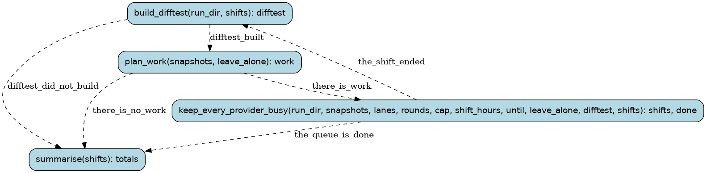

# queue

The shared work queue (review 3 Area 5.3-5): one long run that keeps every provider with quota busy on
the functions left to farm (captured calls, no passing candidate), each routed by its size to one prompt
and an order of models (wf/tools/work_queue.py ROUTES: the old prompt at 11-30 lines, MiniMax-M3 first; the
typed prompt elsewhere). Each provider has a lane of workers. A worker takes the next job whose next model is
its provider's (or, rather than idle, one where its model comes later), runs one farm run on it (one round
plus one repair, review 3 Area 2; runaways are stopped at their reasoning budget) and records the result in
the jobs' ledger, build-wf-state/queue-jobs.json, which every queue run shares. A job keeps its prompt
version, and ends when a candidate passes, every model of its route has tried, or it has spent its token
cap. A provider that is down (rate limit, spent credit, wf/tools/sources.py) takes no jobs until it is
back; Hyper's lane starts again at its daily reset. Functions other farms are on (their `wf farm` arguments)
are left alone. A shift ends every few hours: the difftest is rebuilt from the last commit and the work
planned again. `wf queue --stop` (or SIGTERM) lets the farm runs under way finish and ends the run.

Runs are tracked in the Burr UI under project `recomp-queue`.

## Steps

### `build_difftest` (step)

Build the host difftest from the last commit in a worktree of the queue's own (no farm run is under
way: a shift starts with none).

- reads: `run_dir: Path`, `shifts: tuple[ShiftReport, ...]`
- produces: `difftest: Path | BuildFailure`
- then: `plan_work` when `difftest_built`; `summarise` when `difftest_did_not_build`

### `plan_work` (step)

Find the functions left to farm and give each a job (or keep its open one), with its route.

- reads: `snapshots: SnapshotDir`, `leave_alone: tuple[Path, ...]`
- produces: `work: WorkPlan`
- then: `keep_every_provider_busy` when `there_is_work`; `summarise` when `there_is_no_work`

### `summarise` (step)

Each provider's farm runs, passes, runaways, failures and tokens over every shift
(tools/convert/scorecard.py has the cost in plan units).

- reads: `shifts: tuple[ShiftReport, ...]`
- produces: `totals: tuple[LaneTally, ...]`
- then: the run ends

### `keep_every_provider_busy` (step)

Run every lane's workers until the shift ends, the queue is told to stop or runs out of work; each
farm run is a child run of this step.

- reads: `run_dir: Path`, `snapshots: SnapshotDir`, `lanes: tuple[Lane, ...]`, `rounds: int`, `cap: int`, `shift_hours: float`, `until: float | None`, `leave_alone: tuple[Path, ...]`, `difftest: Path`, `shifts: tuple[ShiftReport, ...]`
- produces: `shifts: tuple[ShiftReport, ...]`, `done: bool`
- then: `build_difftest` when `the_shift_ended`; `summarise` when `the_queue_is_done`
