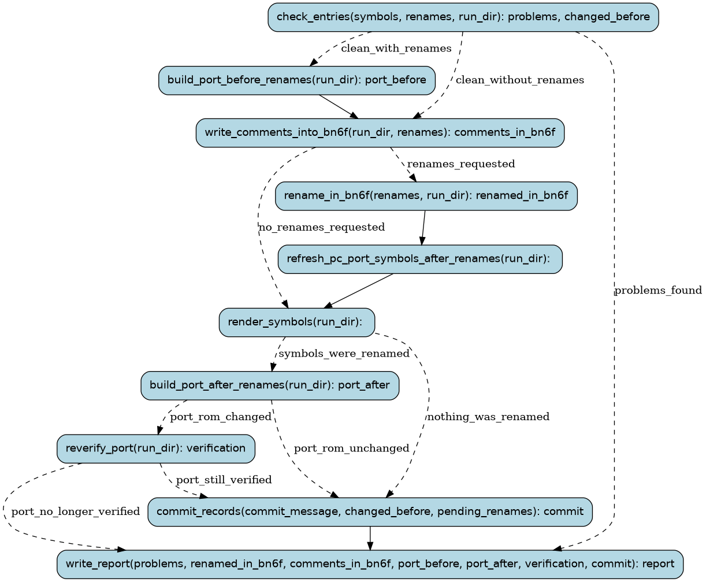

# record

Put what was learnt about symbols into the symbol database and the
disassembly (docs/PROCESS.md §6, and the user's rule: every discovery goes
into bn6f and symbols/db with evidence and how to reproduce it).

Claude writes or updates the symbols/db entries first; this workflow checks
the database, writes the `// symdb:` comments into bn6f, renames symbols in
bn6f (only confirmed or probable meanings), renders SYMBOLS.md, and commits.
bn6f is built once per run: by the rename when there is one (it checks the
comments too), else after the comments. Renames change names, not code: the
port is built before and after them, and re-verified only when its ROM bytes
changed.

Runs are tracked in the Burr UI under project `recomp-record`.

## Steps

### `check_entries` (step)

Check the database, that each symbol has an entry, and that renames have a confirmed or probable meaning;
note what is uncommitted already (other work in the tree is never swept into this run's commit).

- reads: `symbols: tuple[SymbolName, ...]`, `renames: tuple[Rename, ...]`, `run_dir: Path`
- produces: `problems: tuple[ToolMessage, ...]`, `changed_before: tuple[Path, ...]`
- then: `build_port_before_renames` when `clean_with_renames`; `write_comments_into_bn6f` when `clean_without_renames`; `write_report` when `problems_found`

### `build_port_before_renames` (step)

Lift and build the port as it is, to compare the renamed one with byte for byte.

- reads: `run_dir: Path`
- produces: `port_before: str | None`
- then: `write_comments_into_bn6f`

### `write_comments_into_bn6f` (step)

Write each entry's `// symdb:` block at its definition in bn6f (bn6f commit). bn6f is built here
(ROM stays identical) unless renames follow: their build checks the comments too.

- reads: `run_dir: Path`, `renames: tuple[Rename, ...]`
- produces: `comments_in_bn6f: typing.Optional[CommitHash]`
- then: `rename_in_bn6f` when `renames_requested`; `render_symbols` when `no_renames_requested`

### `write_report` (step)

Say what was recorded, or why nothing was.

- reads: `problems: tuple[ToolMessage, ...]`, `renamed_in_bn6f: typing.Optional[CommitHash]`, `comments_in_bn6f: typing.Optional[CommitHash]`, `port_before: str | None`, `port_after: str | None`, `verification: VerifyReport | None`, `commit: typing.Optional[CommitHash]`
- produces: `report: RecordReport`
- then: the run ends

### `rename_in_bn6f` (step)

Rename in bn6f (built once, ROM stays identical, bn6f commit) and in the port's code.

- reads: `renames: tuple[Rename, ...]`, `run_dir: Path`
- produces: `renamed_in_bn6f: CommitHash`
- then: `refresh_pc_port_symbols_after_renames`

### `render_symbols` (step)

Regenerate symbols/SYMBOLS.md and symbols/symdb.sqlite.

- reads: `run_dir: Path`
- produces: nothing
- then: `build_port_after_renames` when `symbols_were_renamed`; `commit_records` when `nothing_was_renamed`

### `refresh_pc_port_symbols_after_renames` (step)

Refresh the PC port's symbol overlay from the renamed bn6f (tools/import_symbols.sh, without building
bn6f again).

- reads: `run_dir: Path`
- produces: nothing
- then: `render_symbols`

### `build_port_after_renames` (step)

Lift and build the renamed port; when its ROM is byte-identical to the one before, it behaves the same.

- reads: `run_dir: Path`
- produces: `port_after: str | None`
- then: `commit_records` when `port_rom_unchanged`; `reverify_port` when `port_rom_changed`

### `commit_records` (step)

Commit the database, the bn6f submodule pointer and the renamed port code locally (and the emptied
list of deferred renames, when that is where this run's renames came from).

- reads: `commit_message: str`, `changed_before: tuple[Path, ...]`, `pending_renames: Path | None`
- produces: `commit: CommitHash`
- then: `write_report`

### `reverify_port` (step)

Renames change the port's layout, not its behaviour: replay every route to make sure (a child verify run).

- reads: `run_dir: Path`
- produces: `verification: VerifyReport`
- then: `commit_records` when `port_still_verified`; `write_report` when `port_no_longer_verified`
