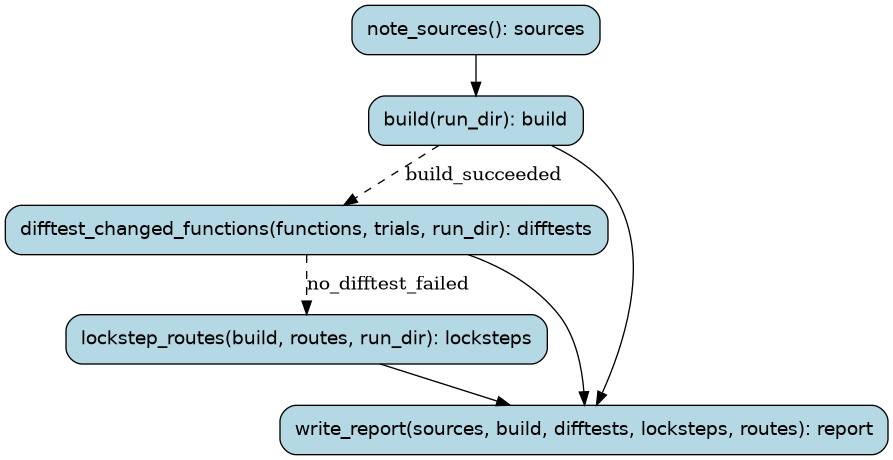

# verify

Verify the main checkout (docs/PROCESS.md §3): lift and build, difftest the
changed functions against their lifted originals on random inputs and on the
original game's captured calls, run them on the CPU oracle, replay every
recorded route in lockstep, and the battle sweep when battle code changed.

Runs are tracked in the Burr UI under project `recomp-verify`.

## Steps

### `note_sources` (step)

Record which commit is being verified, and whether it has uncommitted changes.

- reads: `tree: Path`
- produces: `sources: SourceVersion`
- then: `lift_and_build_everything`

### `lift_and_build_everything` (step)

Lift bn6f with the readable functions in place; build the port ROM and the host difftest.

- reads: `run_dir: Path`, `tree: Path`
- produces: `build: BuiltRom | BuildFailure`
- then: `difftest_random_inputs` when `build_succeeded`; `write_report` when `build_failed`

### `difftest_random_inputs` (step)

Compare each changed function with its lifted original on random inputs.

- reads: `build: BuiltRom`, `functions: tuple[FunctionName, ...]`, `trials: int`, `run_dir: Path`, `tree: Path`
- produces: `difftests: tuple[DifftestResult, ...]`
- then: `difftest_captured_calls`

### `write_report` (step)

Sum up what passed, what failed, what needs triage and what was never compared.

- reads: `sources: SourceVersion`, `build: BuiltRom | BuildFailure`, `functions: tuple[FunctionName, ...]`, `difftests: tuple[DifftestResult, ...]`, `captured_difftests: tuple[CapturedDifftestResult, ...] | NotRun | None`, `oracle: tuple[OracleResult, ...] | NotRun | None`, `routes: tuple[Route, ...]`, `locksteps: tuple[LockstepResult, ...]`, `battle_code: bool`, `battle_sweep: BattleSweepResult | NotRun | None`
- produces: `report: VerifyReport`
- then: the run ends

### `difftest_captured_calls` (step)

Compare each changed function with its lifted original on the original game's own calls.

- reads: `build: BuiltRom`, `functions: tuple[FunctionName, ...]`, `snapshots: typing.Optional[SnapshotDir]`, `run_dir: Path`, `tree: Path`
- produces: `captured_difftests: tuple[CapturedDifftestResult, ...] | NotRun`
- then: `run_cpu_oracle` when `no_difftest_failed`; `write_report` when `some_difftest_failed`

### `run_cpu_oracle` (step)

Run each changed function on the original game and on the port from the same real states.

- reads: `build: BuiltRom`, `functions: tuple[FunctionName, ...]`, `snapshots: typing.Optional[SnapshotDir]`, `oracle_states: int`, `run_dir: Path`, `tree: Path`
- produces: `oracle: tuple[OracleResult, ...] | NotRun`
- then: `lockstep_routes` when `oracle_saw_no_difference`; `write_report` when `oracle_saw_differences`

### `lockstep_routes` (step)

Replay each recorded route on the original game (cached after the first run) and the port side by side.

- reads: `build: BuiltRom`, `routes: tuple[Route, ...]`, `run_dir: Path`
- produces: `locksteps: tuple[LockstepResult, ...]`
- then: `sweep_battles` when `battle_code_changed`; `write_report` when `battle_code_unchanged`

### `sweep_battles` (step)

Replay the 116 recorded battles in lockstep (battle code changed).

- reads: `build: BuiltRom`, `run_dir: Path`
- produces: `battle_sweep: BattleSweepResult`
- then: `write_report`
