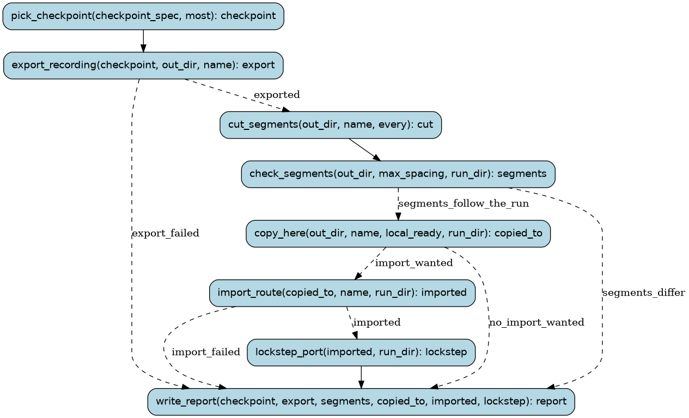

# vidsync-ready

Turn the vidsync sync's newest checkpoint into the `beastsp` route (docs/vidsync/README.md): on the driver
PC, export it as a route-harness recording verified with mgba_run, and cut it into save-file segments (one
about every 20,000 game frames, each checked equal to the run); check the segments; copy the recording and
the segments here (build-vidsync/ready). With --import, tools/import_route.py brings it into
tools/traces/beastsp.* (checkpoints, profiles, coverage, the route's length) and the port is lockstepped on
the longer route; the import replays the whole route here, so it is asked for, not the default.

Runs are tracked in the Burr UI under project `recomp-vidsync`.

## Steps

### `pick_checkpoint` (step)

The checkpoint to export: the one named, or a run's newest (at most `most`), or the last run's newest.

- reads: `checkpoint_spec: typing.Optional[RemotePath]`, `most: typing.Optional[FrameCount]`
- produces: `checkpoint: Checkpoint`
- then: `export_recording`

### `export_recording` (step)

export.sh on the driver PC: the trace, pokes and save, replayed in mgba_run and emu_server, which must agree.

- reads: `checkpoint: Checkpoint`, `out_dir: RemotePath`, `name: str`
- produces: `export: JobResult`
- then: `cut_segments` when `exported`; `write_report` when `export_failed`

### `cut_segments` (step)

segments.sh on the driver PC: save-file segments about every `every` game frames, each replayed against
the run (VERIFY.txt, segments.json).

- reads: `out_dir: RemotePath`, `name: str`, `every: int`
- produces: `cut: JobResult`
- then: `check_segments`

### `write_report` (step)

What was exported, whether the segments follow the run, where it was copied, the import and lockstep.

- reads: `checkpoint: Checkpoint | None`, `export: JobResult | None`, `segments: SegmentCheck | None`, `copied_to: Path | None`, `imported: ImportResult | None`, `lockstep: VerifyReport | None`
- produces: `report: ReadyReport`
- then: the run ends

### `check_segments` (step)

Read segments.json: every segment's game state must equal the run's; long segments and breaks in the
save chain are reported.

- reads: `out_dir: RemotePath`, `max_spacing: int`, `run_dir: Path`
- produces: `segments: SegmentCheck`
- then: `copy_here` when `segments_follow_the_run`; `write_report` when `segments_differ`

### `copy_here` (step)

Copy the recording and the segments (a few MB) from the driver PC to build-vidsync/ready (or local_ready).

- reads: `out_dir: RemotePath`, `name: str`, `local_ready: Path | None`, `run_dir: Path`
- produces: `copied_to: Path`
- then: `import_route` when `import_wanted`; `write_report` when `no_import_wanted`

### `import_route` (step)

tools/import_route.py: the recording into tools/traces/beastsp.*, its checkpoints, window profiles,
coverage, and the route's length in routes.py.

- reads: `copied_to: Path`, `name: str`, `run_dir: Path`
- produces: `imported: ImportResult`
- then: `lockstep_port` when `imported`; `write_report` when `import_failed`

### `lockstep_port` (step)

Lockstep the port on the longer beastsp route (a child verify run: build and lockstep, no functions).

- reads: `imported: ImportResult`, `run_dir: Path`
- produces: `lockstep: VerifyReport`
- then: `write_report`
