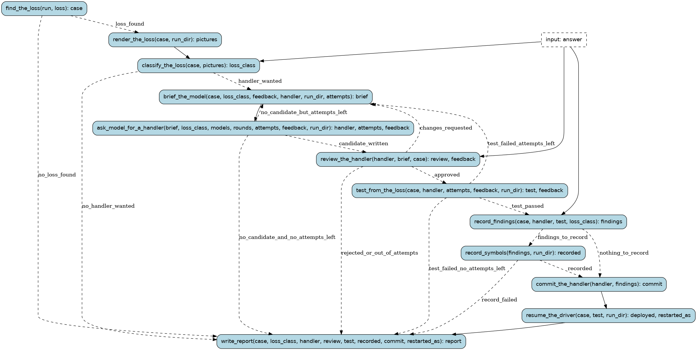

# vidsync-repair

A new repair handler for a loss the vidsync driver could not get past (docs/vidsync/README.md). The loss is
rendered with the probes (the emulator beside the video, and the video after it) on the driver PC; Claude
looks and says what differs and which symbols and routines matter; an outside model writes the handler from a
brief carrying the symbols/db entries and the routines' assembly; Claude reviews it; it is tested from the
loss checkpoint (it must sync 600 frames past the loss on the driver PC's own workers, and the path must then
hold against the video). What was learnt about the game goes into symbols/db and bn6f through `record`; the
handler is committed, deployed, and the driver restarts past the loss.

Runs are tracked in the Burr UI under project `recomp-vidsync`.

## Steps

### `find_the_loss` (step)

The run's loss on the driver PC (remote/loss.py): its loss json, a checkpoint before it, the log.

- reads: `run: RunName`, `loss: typing.Optional[FrameCount]`
- produces: `case: LossCase | None`
- then: `render_the_loss` when `loss_found`; `write_report` when `no_loss_found`

### `render_the_loss` (step)

compare.png (the emulator beside the video, the 150 frames before the loss) and video.png (the video's 8
seconds after it), made on the driver PC with the probes and copied here.

- reads: `case: LossCase`, `run_dir: Path`
- produces: `pictures: tuple[Path, ...]`
- then: `classify_the_loss`

### `write_report` (step)

How the repair ended.

- reads: `case: LossCase | None`, `loss_class: LossClass | None`, `handler: HandlerCandidate | None`, `review: HandlerReview | None`, `test: HandlerTest | None`, `recorded: RecordReport | None`, `commit: typing.Optional[CommitHash]`, `restarted_as: typing.Optional[RunName]`
- produces: `report: RepairReport`
- then: the run ends

### `classify_the_loss` (pause point)

Claude looks at the pictures and the log and says what differs, which symbols/db entries and routines
the model needs, and the handler's name (or that no new handler is wanted).

- reads: `case: LossCase`, `pictures: tuple[Path, ...]`
- waits for: `LossClass` (`kind: LossKind`, `what_differs: str`, `symbols: tuple[SymbolName, ...]`, `routines: tuple[FunctionName, ...]`, `handler_name: HandlerName`, `ask_model: bool`)
- produces: `loss_class: LossClass`
- then: `brief_the_model` when `handler_wanted`; `write_report` when `no_handler_wanted`

### `brief_the_model` (step)

The brief: the loss, what differs, the handler interface, autosync's helpers and the closest built-in
handlers, syms names, the symbols/db entries, the routines' assembly, and what earlier attempts were told.

- reads: `case: LossCase`, `loss_class: LossClass`, `feedback: tuple[str, ...]`, `handler: HandlerCandidate | None`, `run_dir: Path`, `attempts: int`
- produces: `brief: Path`
- then: `ask_model_for_a_handler`

### `ask_model_for_a_handler` (step)

An outside model writes the handler (the strong tier in order, `rounds` attempts each; a provider that is
down is skipped). A reply that cannot be tested (no code, does not compile, no NAME/try_fix) counts as an
attempt and goes back with what was wrong.

- reads: `brief: Path`, `loss_class: LossClass`, `models: tuple[ModelSpec, ...]`, `rounds: int`, `attempts: int`, `feedback: tuple[str, ...]`, `run_dir: Path`
- produces: `handler: HandlerCandidate`, `attempts: int`, `feedback: tuple[str, ...]`
- then: `review_the_handler` when `candidate_written`; `brief_the_model` when `no_candidate_but_attempts_left`; `write_report` when `no_candidate_and_no_attempts_left`

### `review_the_handler` (pause point)

Claude reviews the handler (its code is in handler.code, the brief beside it): approve to test it,
request changes (the notes go to the next attempt), or reject.

- reads: `handler: HandlerCandidate`, `brief: Path`, `case: LossCase`
- waits for: `HandlerReview` (`verdict: ReviewVerdict`, `notes: str`)
- produces: `review: HandlerReview`, `feedback: tuple[str, ...]`
- then: `test_from_the_loss` when `approved`; `brief_the_model` when `changes_requested`; `write_report` when `rejected_or_out_of_attempts`

### `test_from_the_loss` (step)

Put the handler in tools/vidsync/handlers, deploy to the driver PC, and sync from the loss checkpoint
with only that handler to 600 frames past the loss, on that PC's own workers; then pathcheck the path. A
handler that fails is taken out of the tree again.

- reads: `case: LossCase`, `handler: HandlerCandidate`, `attempts: int`, `feedback: tuple[str, ...]`, `run_dir: Path`
- produces: `test: HandlerTest`, `feedback: tuple[str, ...]`
- then: `record_findings` when `test_passed`; `brief_the_model` when `test_failed_attempts_left`; `write_report` when `test_failed_no_attempts_left`

### `record_findings` (pause point)

Claude writes or updates the symbols/db entries for what the handler relies on (evidence: the fix's
poke line and pathcheck on the test result; PROCESS.md §6), then answers with them and the commit
messages.

- reads: `case: LossCase`, `handler: HandlerCandidate`, `test: HandlerTest`, `loss_class: LossClass`
- waits for: `Findings` (`symbols: tuple[SymbolName, ...]`, `renames: tuple[Rename, ...]`, `record_message: str`, `handler_message: str`)
- produces: `findings: Findings`
- then: `record_symbols` when `findings_to_record`; `commit_the_handler` when `nothing_to_record`

### `record_symbols` (step)

The findings through `record` (a child run): symbols/db checked, comments and renames into bn6f, commit.

- reads: `findings: Findings`, `run_dir: Path`
- produces: `recorded: RecordReport`
- then: `commit_the_handler` when `recorded`; `write_report` when `record_failed`

### `commit_the_handler` (step)

Commit tools/vidsync/handlers/NAME.py in the main checkout (holding the main tree's lock).

- reads: `handler: HandlerCandidate`, `findings: Findings`
- produces: `commit: CommitHash`
- then: `resume_the_driver`

### `resume_the_driver` (step)

Deploy the committed handler to both PCs, restart the worker server, and start the driver as the next
run from the test's newest checkpoint past the loss (watch it with `wf vidsync-run --watch`).

- reads: `case: LossCase`, `test: HandlerTest`, `run_dir: Path`
- produces: `deployed: tuple[PcDeploy, ...]`, `restarted_as: typing.Optional[RunName]`
- then: `write_report`
