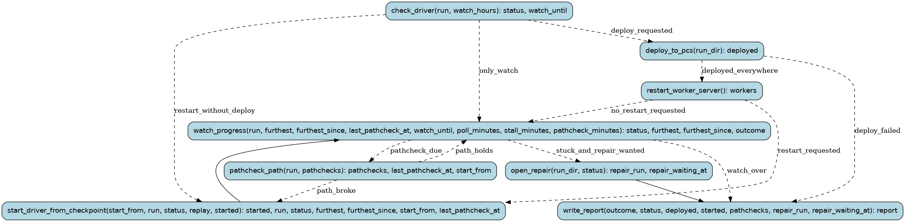

# vidsync-run

Keep the vidsync sync going on the compute PCs (docs/vidsync/README.md): deploy this checkout's vidsync to
both PCs, restart the worker server and the driver from a checkpoint, then watch the driver's progress, the
furthest game frame its logs reached. Every hour the path so far is replayed against the video (pathcheck);
when it does not hold, the driver restarts from a clean checkpoint before its first loss. When the furthest
frame has not moved for 30 minutes (stuck: not log silence, the driver logs while it searches), or the driver
gave up at a loss, a vidsync-repair run is opened for that loss. Without --start the running driver is only
watched; --watch-hours ends the watch after that long whatever happens.

Runs are tracked in the Burr UI under project `recomp-vidsync`.

## Steps

### `check_driver` (step)

Read the driver's state on the driver PC (and so that it answers), and set when the watch ends.

- reads: `run: typing.Optional[RunName]`, `watch_hours: float | None`
- produces: `status: DriverStatus`, `watch_until: float | None`
- then: `deploy_to_pcs` when `deploy_requested`; `start_driver_from_checkpoint` when `restart_without_deploy`; `watch_progress` when `only_watch`

### `deploy_to_pcs` (step)

tools/vidsync/deploy.py: this checkout's tools/vidsync, mgba_run's source and bn6f's symbols to both PCs,
built there (~/vidsync/recomp; their data stays in ~/vidsync/data).

- reads: `run_dir: Path`
- produces: `deployed: tuple[PcDeploy, ...]`
- then: `restart_worker_server` when `deployed_everywhere`; `write_report` when `deploy_failed`

### `start_driver_from_checkpoint` (step)

Stop the driver and start a new run from the checkpoint (job_driver.sh through WMI), named after the
last run (run7k -> run7l) unless named; the progress clock starts again.

- reads: `start_from: typing.Optional[RemotePath]`, `run: typing.Optional[RunName]`, `status: DriverStatus | None`, `replay: typing.Optional[RemotePath]`, `started: tuple[DriverStart, ...]`
- produces: `started: tuple[DriverStart, ...]`, `run: RunName`, `status: DriverStatus`, `furthest: typing.Optional[FrameCount]`, `furthest_since: float | None`, `start_from: typing.Optional[RemotePath]`, `last_pathcheck_at: float | None`
- then: `watch_progress`

### `watch_progress` (step)

Read the driver's state every few minutes until it is stuck (the furthest game frame has not moved for
the stall time), it ended, a pathcheck is due, or the watch is over.

- reads: `run: typing.Optional[RunName]`, `furthest: typing.Optional[FrameCount]`, `furthest_since: float | None`, `last_pathcheck_at: float | None`, `watch_until: float | None`, `poll_minutes: float`, `stall_minutes: float`, `pathcheck_minutes: float`
- produces: `status: DriverStatus`, `furthest: typing.Optional[FrameCount]`, `furthest_since: float`, `outcome: WatchOutcome`
- then: `pathcheck_path` when `pathcheck_due`; `open_repair` when `stuck_and_repair_wanted`; `write_report` when `watch_over`

### `restart_worker_server` (step)

Restart the worker server on 10.67.1.167 from the deployed tree (through WMI); the driver reconnects.

- reads: nothing
- produces: `workers: int`
- then: `start_driver_from_checkpoint` when `restart_requested`; `watch_progress` when `no_restart_requested`

### `write_report` (step)

Where the driver is: its run, the furthest frame, how the watch ended, and the repair opened.

- reads: `outcome: WatchOutcome | None`, `status: DriverStatus | None`, `deployed: tuple[PcDeploy, ...]`, `started: tuple[DriverStart, ...]`, `pathchecks: tuple[Pathcheck, ...]`, `repair_run: str | None`, `repair_waiting_at: str | None`
- produces: `report: VidsyncRunReport`
- then: the run ends

### `pathcheck_path` (step)

Replay the run's newest checkpoint with plain steps against the video (pathcheck.py, a job on the driver
PC). If it does not hold to its end, save a clean checkpoint 300 frames before the first loss
(pathcheck.py --save) for the driver to restart from. A checkpoint checked already is not checked again.

- reads: `run: typing.Optional[RunName]`, `pathchecks: tuple[Pathcheck, ...]`
- produces: `pathchecks: tuple[Pathcheck, ...]`, `last_pathcheck_at: float`, `start_from: typing.Optional[RemotePath]`
- then: `watch_progress` when `path_holds`; `start_driver_from_checkpoint` when `path_broke`

### `open_repair` (step)

Open a vidsync-repair run for the loss the driver is stuck on (a child run: it renders and classifies
the loss, then waits for Claude).

- reads: `run_dir: Path`, `status: DriverStatus | None`
- produces: `repair_run: str`, `repair_waiting_at: str | None`
- then: `write_report`
