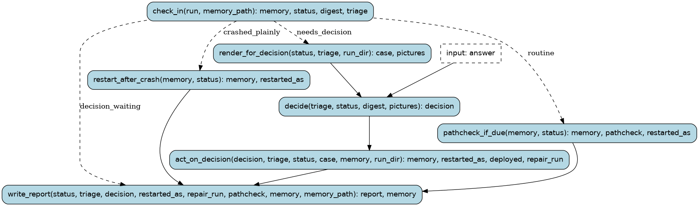

# vidsync-tick

One check-in on the vidsync sync, for a recurring prompt (every 15 minutes): the way the hand-run sync was
kept going (10-10..10-13), as a workflow. It reads the driver's state and the log around the loss it is on
(remote/digest.py), and sorts it (wf/tools/vidsync_triage.py):

- moving, or on a loss for less than 30 minutes: nothing to do; every hour the path is checked against the
  video (pathcheck), and a broken path restarts from a clean checkpoint before its first loss;
  and every hour what the run's new fixes wrote goes into symbols/db (wf/tools/vidsync_learn.py, the fix
  list from remote/fixlog.py): each written field's entry gets a `runtime` evidence item (handler, frames,
  the fix's log line as the repro), committed; written addresses with no entry are listed in
  build-vidsync/learned.md for `record` (nothing is renamed here);
- the driver died without a traceback: restart from its newest checkpoint (at most twice in a row);
- a loop, a suspect fix, a crash with a traceback, an internal error, 30 minutes on one loss, or the driver gave
  up: the loss is rendered and the run stops at `decide`, for Claude to look and choose one Decision:
  wait (snooze this loss), restart from a checkpoint (after a code change: deploy first; a suspect fix:
  the checkpoint before it), open a vidsync-repair run with the loss already classified (a new handler), or
  escalate to the user (time box spent, or the fix needs a decision only the user can make).

A check-in never starts a second decision while one waits: it reports the waiting run instead. What carries
from one check-in to the next (the last pathcheck, snoozed losses, crash restarts, the waiting run) is kept in
build-wf-state/vidsync-tick.json. Every check-in ends with one plain line: game frame, % of the video, fixes,
what it is doing.

Runs are tracked in the Burr UI under project `recomp-vidsync`.

## Steps

### `check_in` (step)

The driver's state, the log digest of the loss it is on, and what they mean (vidsync_triage.triage).
A loss snoozed by an earlier decision is not brought up again until its time is up; a decision still
waiting is not duplicated.

- reads: `run: typing.Optional[RunName]`, `memory_path: Path`
- produces: `memory: TickMemory`, `status: DriverStatus`, `digest: LossDigest | None`, `triage: Triage | None`
- then: `write_report` when `decision_waiting`; `restart_after_crash` when `crashed_plainly`; `render_for_decision` when `needs_decision`; `pathcheck_if_due` when `routine`

### `write_report` (step)

The check-in's one line (game frame, % of the video, fixes, what it is doing, what this check-in did),
and what carries to the next check-in saved.

- reads: `status: DriverStatus | None`, `triage: Triage | None`, `decision: Decision | None`, `restarted_as: typing.Optional[RunName]`, `repair_run: str | None`, `pathcheck: str | None`, `memory: TickMemory | None`, `memory_path: Path`
- produces: `report: TickReport`, `memory: TickMemory | None`
- then: the run ends

### `restart_after_crash` (step)

The driver died with no traceback (supervise.sh gave up, the PC rebooted): start the next run from the
newest checkpoint, at most twice in a row (a third crash before it is seen running is left for Claude).

- reads: `memory: TickMemory`, `status: DriverStatus`
- produces: `memory: TickMemory`, `restarted_as: typing.Optional[RunName]`
- then: `write_report`

### `render_for_decision` (step)

The loss's pictures (the emulator beside the video before the loss, the video after it), made on the
driver PC with the probes (remote/render.py) and copied here; none when there is no loss (a crash).

- reads: `status: DriverStatus`, `triage: Triage`, `run_dir: Path`
- produces: `case: LossCase | None`, `pictures: tuple[Path, ...]`
- then: `decide`

### `pathcheck_if_due` (step)

Once an hour, the run's newest checkpoint replayed with plain steps against the video (pathcheck.py on
the driver PC). When it does not hold, a clean checkpoint 300 frames before the first loss is saved
(pathcheck.py --save) and the driver restarts from it.

- reads: `memory: TickMemory`, `status: DriverStatus`
- produces: `memory: TickMemory`, `pathcheck: str | None`, `restarted_as: typing.Optional[RunName]`
- then: `write_report`

### `decide` (pause point)

Claude looks at the pictures, the triage and the digest (each handler's last line at the loss, the fixes
there, the RNG search) and answers one Decision. Time box: a loss that has taken two hours of looking is
escalated, not looked at again.

- reads: `triage: Triage`, `status: DriverStatus`, `digest: LossDigest | None`, `pictures: tuple[Path, ...]`
- waits for: `Decision` (`action: Action`, `note: str`, `checkpoint: typing.Optional[RemotePath]`, `deploy: bool`, `loss_class: LossClass | None`, `snooze_minutes: float`)
- produces: `decision: Decision`
- then: `act_on_decision`

### `act_on_decision` (step)

Do what Claude decided: snooze the loss, restart (deploying first if asked; a suspect fix's restart goes
from the newest checkpoint before it), open a vidsync-repair run past its classify step, or escalate.

- reads: `decision: Decision`, `triage: Triage`, `status: DriverStatus`, `case: LossCase | None`, `memory: TickMemory`, `run_dir: Path`
- produces: `memory: TickMemory`, `restarted_as: typing.Optional[RunName]`, `deployed: tuple[PcDeploy, ...]`, `repair_run: str | None`
- then: `write_report`
